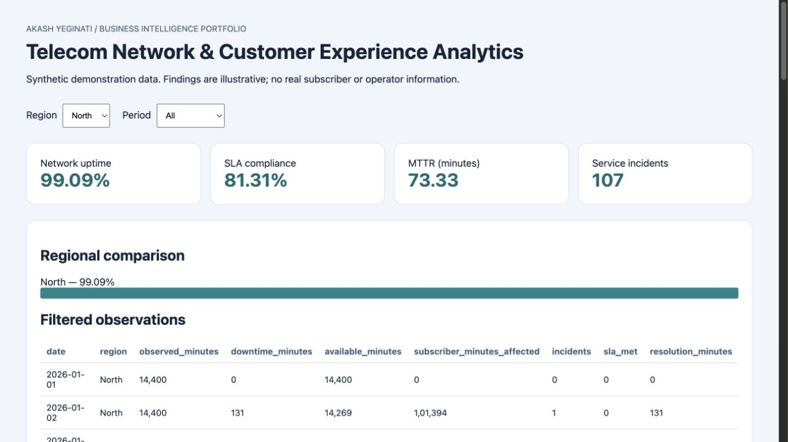

# Telecom Network Performance & Customer Experience Analytics

Reproducible business-intelligence portfolio project created with AI assistance for Akash Yeginati. **All data is synthetic.** This is independent educational work, not a Calix engagement or production telecom system.

## Run in Python 3.11+
```sh
python -m venv .venv
# macOS/Linux: source .venv/bin/activate
# Windows PowerShell: .venv\Scripts\Activate.ps1
python -m pip install -r requirements.txt
python analysis.py
python -m unittest discover -s tests -v
```

Open `reports/dashboard.html` in any browser. It works offline and supports region and period filters. `reports/findings.md` explains generated results, recommendations and metric definitions. Raw/generated CSVs live in `data/`; SQL outputs, evaluation and the SQLite analytical store are rebuilt by the pipeline.

## Power BI
See `powerbi/README.md` for the editable PBIP report, CSV model and DAX measures. Power BI Desktop on Windows is required to refresh and render the native report. Python/SQL results and the offline dashboard are tested separately; no native Desktop rendering is claimed unless explicitly recorded in `VERIFICATION.md`.

## Review before discussing in an interview
Explain data grain, KPI denominators, join cardinality, filtering and limitations. Re-run the pipeline, inspect the SQL and adapt the project yourself. This repository does not establish prior professional Power BI experience or real-world business impact. No percentage reduction or customer-retention lift is claimed.

## Reproducibility and scope
The generator uses a fixed random seed. See code, tests and `reports/findings.md` for assumptions. Results demonstrate technique, not external validity. No passwords, API keys or private customer records are needed.

## Offline dashboard preview



This preview is the HTML dashboard. Native Power BI report sources are provided separately under `powerbi/`.

An optional GitHub Actions definition is in `docs/github-actions-example.yml`. Local tests were run; no automatic GitHub workflow is enabled.
